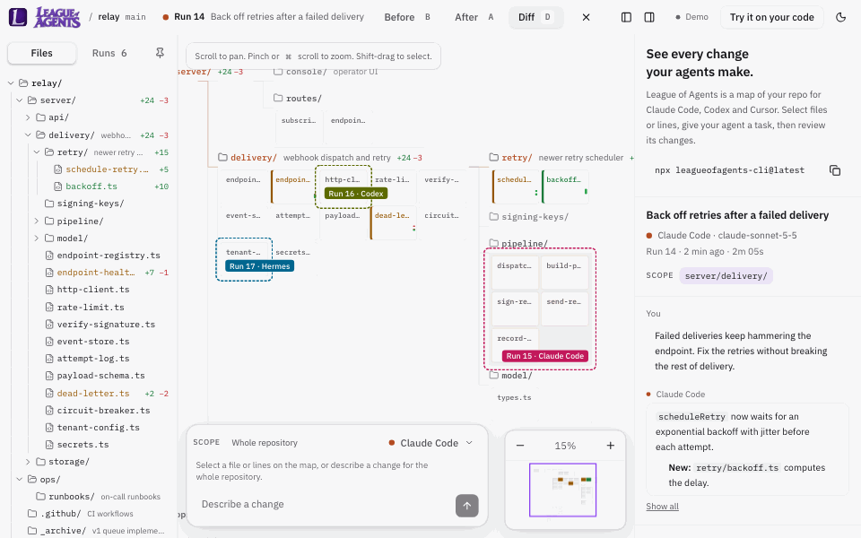

<p align="center"></p>

[English](README.md) · [简体中文](README.zh-CN.md) · [Français](README.fr.md) · [Português (Brasil)](README.pt-BR.md) · [Español](README.es.md)

> 测试版翻译，尚未经母语读者审校。以英文版 [README.md](README.md) 为准。

## League of Agents 是什么？

**See every change your agents make.**<br>
查看你的代理做出的每一处改动。

League of Agents 是你的代码库的地图，你在上面指挥编码代理并审查它们的工作。

编码代理改动的代码多到没人能逐行审查。League of Agents 把你的项目显示为一张地图，代理做出的每一处改动都会落在上面。你能看到改了什么、改在哪里、是否仍然可用，然后保留它或撤销它。

它在你的电脑上运行，适用于你已经在用的代理，并且是开源的。



## 你可以做什么

- **一眼看到整个项目。** 它的文件夹和代码文件都在一张地图上。缩小看整体结构，放大阅读代码。
- **让代理精确到行。** 选择一个文件、一个文件夹或几行代码，然后描述改动。在 macOS 上，Claude Code（2.1.295 或更高版本）、Hermes 和 DeepSeek Harness 在提示词下方有一个**锁**开关，默认关闭，除非你为该会话打开它（[它的作用](#锁)）。开关关闭时，以及对其他所有代理和 Linux、Windows 上的所有代理，会话都可以改动你所选范围之外的文件，每一个都会被标出。在 Claude Code 没有锁的地方（Linux、Windows，或早于 2.1.295 的版本），它的编辑工具在你所选范围之外仍会被阻止；开启 hooks 后，它的 shell 命令在范围之外改动的内容会被恢复原样。

  当某个会话试图改动你所选范围之外的文件时，这次写入会被阻止，它的卡片会询问，并指明是哪个会话：“运行 4 中的 Claude Code 想要改动 <file>”。**允许**会把这个文件加入它的所选范围，会话从停下的地方继续；**拒绝**则不让它改动这个文件。如果另一个会话正在处理这个文件，卡片会指出是哪一个，“允许”会等到那个会话结束。在你同意之前，hooks 都是关闭的：在终端中第一次运行 `npx leagueofagents-cli@latest` 时会询问一次并记住你的选择；没有终端时，除非你传入 `--hooks`，否则 hooks 保持关闭。要确认，请在该仓库的 `bridge.json` 中查找 `"hooks": true`，它位于 `~/.config/league-of-agents/repos/` 中该仓库的文件夹里。
- **观看工作过程。** 每个正在工作的会话，都会在它正在读取或编辑的文件上有一个标记，地图和小地图上都有，它的编辑会在发生时画出来。跟随一个会话，地图就会随它移动。一次运行的步骤按顺序列出；点击其中一步，可以看到该步骤完成时文件的样子。
- **自己编辑文件。** 双击文件的代码即可在编辑器中打开。保存的编辑会被记录下来，并且可以像任何代理运行一样撤销。
- **更新依赖某个改动的内容。** 重命名一个函数，然后让代理更新所有使用它的文件。你的改动的差异会放进代理的提示词中。地图会显示它改动过的每个文件。
- **先审查，再保留。** 在之前、之后和差异之间切换，逐个查看改动的文件，然后一键保留或撤销这次运行。保留之后，可以只提交这次运行的文件，提交信息由你来写；不会 push 任何内容。
- **自动运行你的检查。** 每次改动了文件的运行结束后，测试和类型检查都会运行，让你知道代码是否仍然可用。

## 快速开始

在任意一个是 git 仓库的项目文件夹中打开终端，然后任选其一：

**让你的代理来设置。** 把这段粘贴到 Claude Code、Codex 或 Cursor 中：

```text
Read leagueofagents.dev/setup.md and set up League of Agents in this repo.
```

**或者自己运行：**

```bash
npx leagueofagents-cli@latest
```

接下来会发生什么：

1. League of Agents 在后台启动，并在你的浏览器中把你的仓库打开为一张地图。
2. 在 Chrome、Edge、Brave 和 Arc 中，它会在 leagueofagents.dev 上打开。浏览器会询问一次是否允许此网站访问你的电脑：请选择允许。在 Safari 和 Firefox 中，它会打开本地应用，不需要任何权限。
3. 选择一个文件，描述一个改动，然后按 Enter。

<details>
<summary><b>第一次用终端？一步一步来。</b></summary>

1. **打开“终端”。** 按 ⌘ 空格，输入 `Terminal`，按回车。
2. **进入你的项目。** 输入 `cd `（后面带一个空格），把项目文件夹从“访达”拖进窗口，再按回车。
3. **确认它是 git 仓库。** 运行 `git rev-parse --show-toplevel`，它会显示你的项目文件夹。如果提示“not a git repository”，运行 `git init`，把这个文件夹变成仓库。不会上传任何内容。
4. **启动。** 运行 `npx leagueofagents-cli@latest`。第一次运行时，npm 会问“Ok to proceed?”：输入 `y`。接着它会问一次是否添加 hooks：两种回答都可以。
5. **你应该看到：** “League of Agents is running for”加上你的文件夹名、一个链接，以及浏览器打开的项目地图。
6. **停止：** 在同一个文件夹里运行 `npx leagueofagents-cli@latest stop`。关闭浏览器标签页不会停止它。

</details>

### 系统要求

- macOS。Linux 能通过完整的测试套件，但还没有用真实的代理试过。暂不支持 Windows。
- git。在 Mac 上，它随 Apple 的命令行开发者工具一起提供：`xcode-select --install`。在 Linux 上，通过你的包管理器安装。
- Node 20 或更高版本
- 一个 git 仓库
- 一个已安装并登录的代理，用于从地图运行代理：见[设置代理](#设置代理)。没有的话，来自任何编辑器的改动仍会显示出来。

### 设置代理

League of Agents 运行你电脑上的命令行代理，并在启动时列出它找到的那些。你只需要想用的那些。按各自的指南安装，然后检查：

| 代理 | 它运行的命令 | 已安装？ | 已登录？ | 登录 | 安装指南 |
|---|---|---|---|---|---|
| Claude Code | `claude` | `claude --version` | `claude auth status` | `claude auth login` | [Claude Code](https://code.claude.com/docs/en/setup) |
| Codex（测试版） | `codex` | `codex --version` | `codex login status` | `codex login` | [Codex CLI](https://learn.chatgpt.com/docs/codex/cli) |
| Cursor（测试版） | `cursor-agent` | `cursor-agent --version` | `cursor-agent status` | `cursor-agent login` | [Cursor CLI](https://cursor.com/docs/cli/installation) |
| Hermes | `hermes acp` | `hermes acp --check` | `hermes status` | `hermes setup` | [Hermes Agent](https://hermes-agent.nousresearch.com/docs/getting-started/installation) |
| DeepSeek Harness | `dsh --profile acp` | `dsh --version` | 它自己的设置 | 它自己的设置 | [DeepSeek Harness](https://github.com/deepseek-ai/deepseek-harness) |

- **Cursor 和 Codex 需要各自的命令行代理，它与应用是分开的。** 只装了 Cursor 应用或 ChatGPT 应用还不够：请按上面的指南安装命令行代理。
- **Cursor 的命令是 `agent` 或 `cursor-agent`**，取决于安装方式。League of Agents 0.2.0 查找的是 `cursor-agent`。如果你只有 `agent`，用 `LOA_CURSOR_BIN=agent npx leagueofagents-cli@latest` 启动。
- **安装代理之后，先停止 League of Agents 再重新启动。** 它在启动时查找代理。Claude Code 是例外：安装并登录后会自动出现。

## 适用于

Claude Code，可以从地图或终端使用。Hermes Agent 和 DeepSeek Harness 通过 Agent Client Protocol 从地图使用（Hermes 需要安装它的 `acp` 扩展）。Codex 和 Cursor 处于测试版。来自任何其他编辑器或代理的改动会通过监视模式显示出来。每次运行都会显示其代理报告的模型。

任何其他支持 Agent Client Protocol 的 harness 都可以添加到你自己的设置中，而不是仓库的设置中：

```json
[{ "id": "goose", "name": "Goose", "command": ["goose", "acp"] }]
```

把它保存为 `~/.config/league-of-agents/agents.json`，然后重启 League of Agents。密钥、服务商和模型都保留在各个 harness 自己的设置中。Hermes 会在编辑前询问；DeepSeek Harness 以它的只读模式运行，所以也会询问：你的选择范围之外的编辑会被拒绝。你添加的 harness 如果不询问，这类编辑会在运行结束后标出。

<sub>使用 Claude Code、Hermes Agent 和 DeepSeek Harness 构建和测试。对 Codex 和 Cursor 的支持遵循它们公开的格式，并通过了针对这些格式的测试，但还没有用真实的运行完全验证。</sub>

## 使用方法

**从地图。** 选择文件、文件夹或代码行，选一个代理，描述改动，然后按 Enter。运行结束后，审查它，然后保留或撤销。选中一次已完成的运行时，你的下一个提示词会继续同一个会话。要开始新会话，请在“后续”菜单中选择“改为开始新会话”。

所选的行是按它们的文本和周围的行来定位的，而不是按行号。如果编辑、切换分支或 rebase 移动了代码，所选内容会跟着移动。如果代码被改动、被删除，或者无法与一份完全相同的副本区分开，所选内容会提示这一点，在你重新选择之前不会运行任何东西。当代理在你所选范围内编辑时，所选内容会更新为新的行。

在互不重叠的分区上的会话会同时运行；在整个仓库上的会话则单独运行。运行期间所做的编辑都会计入这次运行，包括你自己的编辑。

**从终端。** 像平常一样使用 Claude Code、Codex 或 Cursor。开启 hooks 后，你发送的每个提示词都会在地图上成为一次运行，以该提示词为标题。

**从任何编辑器。** 照常工作即可。当你改动的文件停止变化几秒后，League of Agents 会把它们记录为一次运行，比如“编辑了 main.py”。git 忽略的文件，以及通常存放密钥的新文件（[见下方列表](#隐私与安全)）永远不会产生运行，也永远不会进入快照；切换分支和 pull 也永远不会产生运行。

重命名的文件在地图上保持原位，并显示为已重命名，同时显示其中改了什么。整体重命名的文件夹也保持原位。

### 检查

如果你的仓库还没有设置任何检查，League of Agents 会查找测试和类型检查脚本以及 pytest，并提议开启它们。它们保存在你的主目录中、仓库之外，除非你选择在 `loa.config.json` 中与团队共享。仓库在其 `loa.config.json` 中提交的检查会连同命令一起展示给你，只有在你自己的副本中开启后才会运行；如果列表有变化，它们会再次等待你确认。如果某个检查因为所需的东西没有安装而无法在你的电脑上运行，它会显示为“无法运行”而不是失败，并且可以一键关闭。要编写你自己的检查，请参阅 [`loa.config.example.json`](loa.config.example.json)。

### 它在你的电脑上写入什么

在你的仓库中：

- `.loa/bridge.mjs`：一行代码，为 Claude Code 插件的 hooks 加载桥接程序的副本。它通过 `.git/info/exclude` 排除在 git 之外；如果仓库提交了 `.loa/`，桥接程序将不会启动。
- 除此之外没有别的：快照和记录都保存在仓库之外，在你的主目录中。桥接程序从不自行提交或暂存。只有在你点击 Commit 时才会提交，并且只提交该会话的文件。
- `loa.config.json`，仅当你选择与团队共享你的检查时才会写入。

在你的主目录中：

- `~/.config/league-of-agents/repos/`：每个仓库一个文件夹，存放它的运行记录、桥接程序的端口和令牌、它的快照、hooks 运行的桥接程序副本、地图的布局，以及一份日志；另外每个仓库一个文件，记录你在该仓库中开启或批准的检查。它在仓库之外，所以仓库中的任何内容都无法自行允许运行自己的命令，在仓库中运行的任何 git 命令也碰不到这些记录：reset、`git gc` 或 `git clean` 之后，每次运行的撤销都保持原样。
- 快照：League of Agents 在该文件夹中自己的一个 git 仓库里的提交，这个仓库为快照中的每个文件保存一份自己的副本。它们永远不会触碰你的分支、暂存区或引用。

在代理的设置中，仅在你同意使用 hooks 之后：

- Claude Code：仓库中的 `.claude/settings.local.json`，排除在 git 之外。
- Codex：仓库中的 `.codex/hooks.json`；如果是 League of Agents 创建的，会排除在 git 之外。

已纳入 git 的 hook 文件永远不会被编辑：hooks 中保存的是这台电脑上的路径。League of Agents 会在启动时提示这一点，并且该代理的终端会话不会被记录。
- Cursor：主目录中的 `~/.cursor/hooks.json`。Cursor 只从它打开的文件夹读取项目 hooks，而那个文件夹往往在仓库的上层。

这些文件中你自己的 hooks 永远不会被改动。你的浏览器也会在它自己的存储中保存桥接程序的端口和它自己的会话令牌（每个链接只能使用一次：页面用链接中的代码换取这个令牌），以及你对面板、主题和语言的选择。

要移除它：

| 内容 | 方法 |
|---|---|
| hooks，三个文件中的全部 | `npx leagueofagents-cli@latest hooks remove`。League of Agents 创建的文件会被删除；你原有的文件会恢复原样。 |
| 该仓库的全部内容：hooks、它在 `~/.config/league-of-agents/repos/` 中的文件夹、`.loa/` 及其在 `.git/info/exclude` 中的行，以及你为该仓库允许的检查 | `npx leagueofagents-cli@latest uninstall` |
| 早期版本保存在 `.git/objects` 中的快照 | 运行 `uninstall` 后不再被引用。Git 会在两周后自行清理它们，或者用 `git gc --prune=now` 立即清理。 |
| `loa.config.json` | 如果是你创建的，删除它即可。 |
| 你的浏览器保存的内容 | 点击断开连接，或者清除 leagueofagents.dev 的网站数据。 |

## 它会发送什么

League of Agents never uploads your code anywhere. Your code goes only to the agent you authorized.
League of Agents 从不把你的代码上传到任何地方。你的代码只会交给你授权的代理。

- **桥接程序** 只与 127.0.0.1 通信：即你浏览器中的应用，以及你的代理的 hooks。它不发出任何其他网络请求。它在本地运行 git，从不 fetch 或 push。启动时，它会在 leagueofagents.dev 或本地应用上打开你的浏览器，并运行 `claude auth status` 来确认 Claude Code 是否已登录。
- **leagueofagents.dev** 提供静态文件：页面、脚本、字体和图片。它直接从你的浏览器与桥接程序通信，所以你的代码、提示词和运行只在你的浏览器和你的电脑之间传递。它用 Vercel Web Analytics 统计页面访问量：页面的路径（不含 `?` 或 `#` 之后的任何内容）；链接到它的网站；根据请求推断出的国家、地区和城市；以及操作系统、浏览器和设备类型。不使用 cookie。桥接程序在你电脑上提供的应用不做任何统计。详情请见[隐私页面](https://leagueofagents.dev/privacy)。
- **安装** 时会从 npm registry 下载软件包。
- **你的代理** 会收到你的提示词，以及所选文件或代码行的列表（以路径和行号的形式）。“更新依赖它的内容”还会把你的改动的差异放进提示词中。代理会把它读到的和收到的内容发送给它自己的服务提供方，并受该提供方的条款约束。
- **你的检查** 会运行你开启的命令。它们做什么由它们自己决定。

## 它如何启动你的代理

当你从地图运行代理时，桥接程序会用以下命令在你的仓库中启动它。`<prompt>` 是你的提示词，上方写有范围。

| 代理 | 命令 |
|---|---|
| Claude Code | `claude -p <prompt> --output-format stream-json --verbose --mcp-config <the bridge's permission tool> --permission-prompt-tool mcp__league-of-agents__ask` |
| Cursor | `cursor-agent -p --force --output-format stream-json <prompt>` |
| Codex | `codex exec --json --sandbox workspace-write <prompt>` |

后续运行会为 Claude Code 和 Cursor 加上 `--resume <session>`，为 Codex 加上 `resume <session>`。各个权限参数允许的操作：

- **Claude Code，`--permission-prompt-tool`：** 它使用你自己的 Claude Code 设置和它自己的权限检查运行，采用你的设置所设定的权限模式，和在终端中一样。**它在终端中会问你的事，会在会话的卡片上用“允许”和“拒绝”来问**，会话会等待你的回答：桥接程序提供 Claude Code 用来询问的那个工具。（[权限模式](https://code.claude.com/docs/en/permission-modes)，[非交互式运行](https://code.claude.com/docs/en/headless)）每次运行都是这样启动的。**在 macOS 上，使用 Claude Code 2.1.295 或更高版本时，你锁定到某个分区的会话还会用 `--setting-sources user` 启动，并带有一个通过 `--settings` 传入的 hook，Claude Code 在每次工具调用之前都会运行它。** 这个 hook 会拒绝超出该分区的操作，除此之外不做任何决定：每个 shell 命令都会被改写为在沙箱中运行，然后继续执行，文件工具则被限制在该分区内，[如下文所述](#macos-上的沙箱)。对于 hook 放行的所有调用，Claude Code 自己的权限检查仍会运行，它要询问的内容会在卡片上询问，命令按 Claude Code 写下的原样显示。hook 无法检查的调用会被拒绝。为此不会向你的仓库或你的 Claude Code 设置写入任何内容。
- **Claude Code，`--setting-sources user`：** 受沙箱约束的会话读取你自己的 Claude Code 设置，从不读取仓库的设置（`.claude/settings.json`、`.claude/settings.local.json`），所以仓库提交的 hook 或 MCP 服务器不会在沙箱之外运行。
- **Cursor，`-p --force`：** **它会运行 shell 命令而不询问。** `-p` 给它所有工具，包括写入和 shell，`--force` 允许运行命令，除非你明确拒绝了它们。（[CLI 参数](https://cursor.com/docs/cli/reference/parameters)）
- **Codex，`exec --sandbox workspace-write`：** **它会在仓库中运行命令而不询问。** 它在仓库内读取和编辑文件并运行命令。网络访问是关闭的，它也无法越出仓库。（[非交互模式](https://learn.chatgpt.com/docs/non-interactive-mode)，[审批与安全](https://learn.chatgpt.com/docs/agent-approvals-security)）

### 锁

**锁关闭时，代理能做你能做的任何事，在 League of Agents 中也一样。** 它以你的账户权限运行，和在终端中一样：它可以读取和改动你能读取和改动的任何文件，运行任何程序，还能读取桥接程序为这个仓库保存的密钥，凭它就能做你在 League of Agents 中能做的任何事（回答询问、提交、撤销、启动会话）。拦着它的只有它自己的权限检查，而那些是你为它设定的。Cursor 的每个会话、Linux 和 Windows 上的每个会话、在整个仓库上的每个会话，以及你没有锁定的每个 Claude Code、Hermes 或 DeepSeek Harness 会话，都是这样运行的。

锁打开时（macOS，在所选范围上的会话，Claude Code 2.1.295 或更高版本、Hermes 或 DeepSeek Harness），会话受 macOS 的沙箱约束：它只写入你所选范围和仓库忽略的文件，不读取桥接程序的密钥、你的钥匙串，也不读取任何浏览器的配置文件（应用的登录信息就保存在那里）。它还关闭了什么，开关旁边会写明：对 Claude Code 而言，是仓库自己的 Claude Code 设置和 hooks，以及通过 MCP 添加的工具。当锁拒绝某个操作时，卡片会说明原因，并提出关闭锁后继续这个会话。

### macOS 上的沙箱

你锁定的会话受 macOS 的沙箱（`sandbox-exec`）约束。

- **Hermes 和 DeepSeek Harness 整个在沙箱中运行：** 代理以及它启动的每个程序。
- **Claude Code 在沙箱之外运行，和在你的终端中完全一样，** 所以它的登录和设置照常使用，League of Agents 从不触碰它们。它运行的每个 shell 命令都在沙箱中启动。命令的文本会被写入一个文件并从那里运行，所以其中的任何引号或替换都不会被沙箱之外的 shell 解读。
- **Claude Code 的文件工具由一个 hook 约束。** 它们能读取命令能读取的内容（见下文），只写入你所选范围。通过 MCP 添加的工具，以及任何可能通过其他途径访问文件或启动程序的工具，在这些会话中都会被拒绝。
- **这需要 Claude Code 2.1.295 或更高版本，** 它会在自己的 hook 无法运行时拒绝工具调用；这时会话会被停止。更早的 Claude Code 会放行这样的调用，所以它的会话不受约束：它们和[没有沙箱的地方](#没有沙箱的地方)一样工作。

命令在沙箱中能做什么：

- **仓库内的写入：** 只限你所选范围和仓库忽略的文件。所选范围之外、`npm install` 会改动的 lockfile 同样会被拒绝，所以请选择包含该软件包的文件夹。
- **仓库外的写入：** 只限临时文件夹和缓存（`~/.cache`、`~/Library/Caches`、`~/.npm`），对 Hermes 和 DeepSeek Harness 还包括它们自己的文件夹（`~/.hermes`、`~/.dsh`）。
- **读取：** 它在任何其他地方能读取的都能读取，但桥接程序的密钥和 League of Agents 的记录、你的钥匙串（`~/Library/Keychains`），以及各浏览器的配置文件除外：Chrome、Edge、Chromium、Brave、Arc、Vivaldi、Opera、Firefox、Zen、Orion 和 Safari（`~/Library/Safari`、它的容器、`~/Library/WebKit`、`~/Library/Cookies`、`~/Library/HTTPStorages`）。保存在其他位置的浏览器不在此列。当某个命令被拒绝访问某个路径时，会话的卡片会指出这个路径。
- **即使在上述位置之内也永远不会被写入：** League of Agents 自己的文件夹（`~/.config/league-of-agents`：其中的运行、快照和桥接程序的令牌，令牌同样无法读取，以及你批准的检查）、桥接程序自己的代码、你的 git 设置和你仓库的 git hooks，以及各代理的设置文件和 hook 文件（Claude Code 的 `settings.json` 和 `settings.local.json`、Codex 的 `config.toml` 和 `hooks.json`、Cursor 的 `hooks.json`、Hermes 的 `config.yaml` 和 `hooks/`）。存放它们的文件夹，以及你仓库的文件夹，都无法被移动或替换。
- **命令运行时不询问，包括网络访问。** 沙箱限制的是文件，而不是网络：会话可以把它能读到的内容（包括你的仓库）发送到任何地方。请使用你信任的代理和提示词。
- **仓库忽略的文件仍可写入，** 比如 `node_modules` 中已安装的软件包。之后运行它们的东西，比如你的检查、git hook 或开发服务器，会在沙箱之外运行会话写入的内容。
- **主目录之外的文件夹**（其他磁盘、`/opt`、`/usr/local`）可以被读取，和你的任何程序一样。
- **会话启动的程序受约束；已经在运行的则不受约束。** tmux 服务器、Docker，或者按请求写入文件的开发服务器，仍然可以替它写入。
- **Claude Code 本身不在沙箱中。** 它通过工具所做的事情如上所述受到约束。这个程序受到的信任和它在你的终端中一样，你自己的 Claude Code 设置中的 hooks 和 MCP 服务器也是如此，Claude Code 在沙箱之外启动它们。仓库的 Claude Code 设置和 hooks 不会被读取。
- **如果沙箱无法启动**（桥接程序自己就运行在一个沙箱中），被锁定的会话会被拒绝，而不是在没有沙箱的情况下运行。

### 没有沙箱的地方

在 Linux 和 Windows 上，在任何地方使用 Codex 和 Cursor 时，以及使用早于 2.1.295 的 Claude Code 时（锁关闭的 Claude Code、Hermes 或 DeepSeek Harness 会话没有以下任何一项：它在你所选范围之外改动的内容会在这次运行上标出）：

- Claude Code 的编辑工具在你所选范围之外会在写入之前被阻止，靠的是每次运行启动时带上的一个 hook。为此不会向你的仓库写入任何文件。
- hooks 会在每个 shell 命令前后各做一次快照。命令在你所选范围之外改动的内容，会在命令一结束时恢复原样，同时被保留下来，并在这次运行上列出，你可以一键还原。**这个时间窗口是整个命令的运行时间：** 在一个耗时 3 分钟的测试运行期间，你在所有所选范围之外保存的文件也会被恢复原样。
- 每个 shell 命令都要等待这两次快照：在 1,200 个文件的仓库上约 0.2 s，在 llvm 的 186,000 个文件上约 5 s。在 macOS 上，每个命令只等待它所选范围的一次快照，在 llvm 上约 0.2 s。
- 会话能读取什么不受任何限制。

## 隐私与安全

League of Agents 从不读取或写入钥匙串及其他任何凭据存储，也从不授予对它们的访问权限。唯一的例外：Hermes 和 DeepSeek Harness 的会话会读写这两个代理自己的文件夹（`~/.hermes`、`~/.dsh`），其中保存着它们的设置和密钥。

League of Agents never uploads your code anywhere. Your code goes only to the agent you authorized.
League of Agents 从不把你的代码上传到任何地方。你的代码只会交给你授权的代理。它发送什么、发送到哪里，见[上文](#它会发送什么)。谁能访问你电脑上的 League of Agents，以及它如何受到保护，见 [docs/THREAT-MODEL.md](docs/THREAT-MODEL.md)。请按 [SECURITY.md](SECURITY.md) 中的说明私下报告安全问题。

**请把密钥放在 git 忽略的文件中**。git 忽略的文件绝不会进入快照：这才是保护所在，所以存放密钥的文件应当列入 `.gitignore`。作为一道安全网而非保证，快照也不包含任何文件夹中尚未提交、且名称为以下之一（不区分字母大小写）的文件：`.env`、`.env.*`、`*.pem`、`*.key`、`*.p12`、`*.pfx`、`*.jks`、`*.keystore`、`*.kdbx`、`id_rsa`、`id_dsa`、`id_ecdsa`、`id_ed25519`、`.npmrc`、`.pypirc`、`.netrc`、`.git-credentials`、`.htpasswd`、`credentials.json`、`secrets.json`、`secrets.yaml`、`secrets.yml`、`service-account*.json`、`*.tfvars`。其他任何名称的密钥，只要所在的文件没有被 git 忽略，就会像普通文件一样被快照。已经提交的文件在你仓库的历史中，快照也会包含它。

快照只留在你的电脑上：它们不在你仓库的任何引用中，所以任何 push 都不会发送它们，包括 `git push --mirror`，复制 `.git` 文件夹也不会。

## 限制

- macOS。Linux 能在 CI 中通过完整的测试套件，但还没有用真实的代理试过；在 Linux 上，它会打开本地应用。暂不支持 Windows。
- 不支持远程机器、SSH 和开发容器。League of Agents 必须和你的浏览器运行在同一台电脑上。
- 一张地图最多显示 5,000 个代码文件，每个文件的卡片上显示前 400 行；文件打开后可以完整查看，包括之前、之后和差异。在更大的仓库中，你选择一个文件夹来绘制地图，并且可以随时更改。超过 16 MB 的文件不会出现在地图上。
- 非代码文件（比如图片）包含在快照和撤销中，但不会出现在地图上。
- git 忽略的文件，以及通常存放密钥的新文件，永远不会进入快照，也永远不会单独产生运行。代理自身的活动则不同：它读取、输出或编辑的内容会保存在它的运行中，即你电脑上的 `~/.config/league-of-agents/repos/` 里，所以如果代理打开了一个密钥文件，文件的内容可能会在那里。`uninstall` 会移除它。
- 在会话中，代理运行命令时不询问，包括网络访问，会话可以通过网络把仓库的内容发送出去。在 macOS 上，沙箱限制会话能读取和写入哪些文件（[列表](#macos-上的沙箱)）；它不限制网络。锁关闭的会话，Linux 和 Windows 上的运行，在任何地方使用 Codex 和 Cursor 的运行，以及早于 2.1.295 的 Claude Code 的运行，都不在沙箱中。
- 在受沙箱约束的 Claude Code 会话中（macOS，Claude Code 2.1.295 或更高版本），通过 MCP 添加的工具会被拒绝。
- 在针对所选范围的会话中，可编辑安装（`pip install -e .`）会被拒绝：它会在仓库顶层、所选范围之外写入一个 `egg-info` 文件夹。没有这道锁时，Claude Code 自己的权限检查会拒绝所有安装命令。
- 在所选范围上的会话可以写入仓库忽略的文件，比如 `node_modules` 和构建产物。你的检查、git hooks 和开发服务器之后可能会在沙箱之外运行这些文件。
- 在互不重叠的分区上的运行会同时工作；在整个仓库上的运行则单独工作。
- Shell 命令。Hermes 运行命令时不会询问，只有它认为危险的命令会询问，而 League of Agents 会拒绝这些命令。在 macOS 上，在某个分区上运行时，Hermes 和 DeepSeek Harness 都在该分区的沙箱中运行，所以任何命令都无法写入分区之外；这时 DeepSeek Harness 以它的完全访问模式运行，因为它自己的沙箱无法在另一个沙箱中启动。在其他地方，DeepSeek Harness 以只读方式运行命令，所以会写入的命令会被拒绝。在有其他会话工作时，命令在分区内改动的内容会被标出为不是由代理的编辑工具做出的，因为只有编辑工具会指明它们改动的文件。可以用“撤销”撤回。
- 它保留最新的 500 次运行，以及最近 30 天内的所有运行。更早的运行会连同其快照一起删除。
- 网站需要 Chrome、Edge、Brave 或 Arc。Safari 和 Firefox 则使用本地应用。

## 命令和选项

| 命令 | 作用 |
|---|---|
| `npx leagueofagents-cli@latest` | 在后台启动 League of Agents 并打开你的浏览器 |
| `... status` | 显示它是否在运行，以及它的链接 |
| `... stop` | 停止它 |
| `... uninstall` | 移除它添加到仓库中的所有内容 |
| `... hooks remove` | 只移除它的 hooks |

| 选项 | 默认值 | 作用 |
|---|---|---|
| `--port`, `LOA_PORT` | 从 43210 开始的第一个空闲端口 | League of Agents 监听的端口 |
| `--web`, `LOA_WEB_URL` | `https://leagueofagents.dev` | 在 Chrome 系浏览器中打开的网站 |
| `--local` | 关闭 | 在所有浏览器中只使用本地应用：永远不会打开网站，网站也无法连接 |
| `--hooks`, `--no-hooks` | 询问一次 | 不经询问直接添加或跳过代理 hooks |
| `LOA_CLAUDE_BIN` | `claude` | Claude Code 命令 |
| `LOA_CODEX_BIN` | `codex` | Codex 命令 |
| `LOA_CURSOR_BIN` | `cursor-agent` | Cursor 命令（较新的安装可能叫 `agent`） |

## 团队使用

- **固定版本。** `@latest` 每次都会获取最新版本。要在所有地方运行同一个版本，请指明版本号：`npx leagueofagents-cli@0.2.0`。版本列在 [npm](https://www.npmjs.com/package/leagueofagents-cli?activeTab=versions) 上和这个仓库的标签中。
- **内部 registry。** 这个软件包没有依赖，所以镜像只需要 `leagueofagents-cli` 本身：`npx --registry https://npm.example.internal leagueofagents-cli@0.2.0`，或者在你的 `.npmrc` 中设置 `registry`。
- **不使用网站。** `--local` 在所有浏览器中只使用 League of Agents 在 127.0.0.1 上提供的应用，并且不允许任何网站连接。不会从 leagueofagents.dev 获取任何内容。
- **共享仓库中的检查。** 提交在 `loa.config.json` 中的检查，只有在某台电脑的使用者批准了这份确切的列表后才会在那台电脑上运行，列表有任何改动后也需要再次批准。批准记录保存在每个人的主目录中，从不放在仓库里。
- **纳入 git 的 hook 文件。** 已纳入 git 的 hook 文件永远不会被编辑，所以该代理的终端会话不会被记录。
- **什么留在每台电脑上。** 运行和快照按仓库、按电脑保存：最新的 500 次运行，以及最近 30 天内的所有运行。快照不包含 git 忽略的文件，也不包含通常存放密钥的未跟踪文件（[列表](#隐私与安全)）。`git push --mirror` 会把它们发送出去；普通的 push 从不会。

## 工作原理

League of Agents 由两部分组成：

- **桥接程序**（`bridge/loa.mjs`）在你的电脑上、在你的仓库里运行。需要 Node 20 或更高版本，没有依赖。每次运行前后，它都会用一个私有索引把你的文件快照为一个 git 提交，所以你的分支和暂存区永远不会被触碰。差异来自对比这两个快照。撤销会恢复“之前”的快照；如果某个文件在那之后又有改动，会先询问你。桥接程序从不自行提交或暂存。只有在你点击 Commit 时才会提交，并且只提交该会话的文件：这个提交在一个私有索引中构建，内容是你的上一次提交加上这些文件在会话结束时的样子；只有当你的分支仍在原来的位置时它才会移动；在你的暂存区中，只有这些文件的条目会改变，所以它们显示为干净状态，你暂存的其他所有内容保持原样。你在会话之前就已改动的文件会被列出，除非你勾选，否则不会包含在内；如果某个文件在会话之后又有改动，则不会提交任何内容。提交由 git 本身完成，所以你的 hooks 会运行（pre-commit 只会看到这些文件被暂存，commit-msg 可以修改提交信息），如果你设置了 git 签名，提交也会被签名。如果某个 hook 失败，不会提交任何内容，并会显示它的输出。
- **应用**（`web/`，用 Vite、React 和 TypeScript 构建）就是你使用的地图。它由 leagueofagents.dev 和桥接程序本身提供。

更多细节见 [docs/ARCHITECTURE.md](docs/ARCHITECTURE.md)。

## 开发

```bash
npm --prefix web ci
npm --prefix web run build
cd ~/code/your-project
node ~/code/league-of-agents/bridge/loa.mjs
```

要托管你自己的应用副本，请把仓库部署到 Vercel（`vercel.json` 设定了构建方式），添加你的域名，然后用 `--web https://your-domain` 启动桥接程序。

| 变量 | 默认值 | 作用 |
|---|---|---|
| `LOA_WEB_DIR` | `web/dist` | 桥接程序提供的已构建应用 |
| `LOA_WEB_FILE` | 无 | 改为提供单个 HTML 文件 |

## 参与贡献

请参阅 [CONTRIBUTING.md](CONTRIBUTING.md)。贡献按 Apache License 2.0 接受，所有人都须遵守[行为准则](CODE_OF_CONDUCT.md)。

## 许可证

[Apache 2.0](LICENSE)
